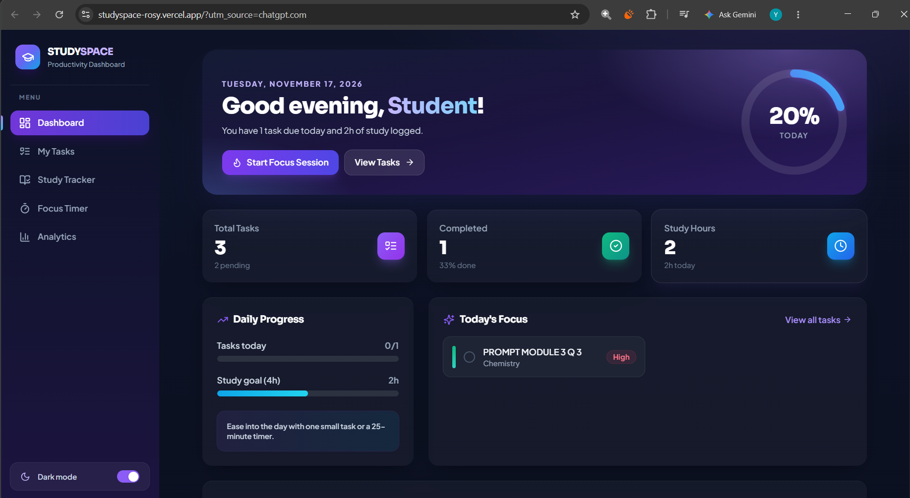
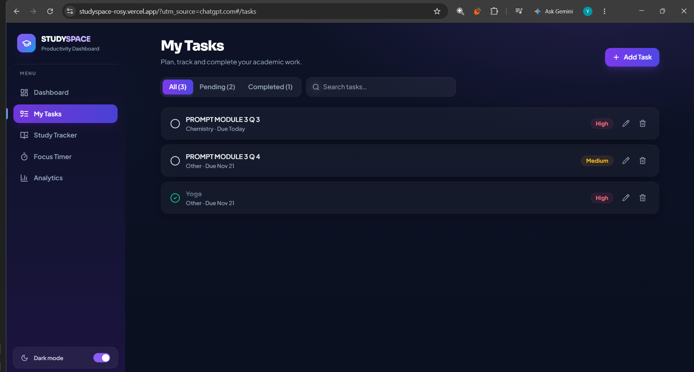
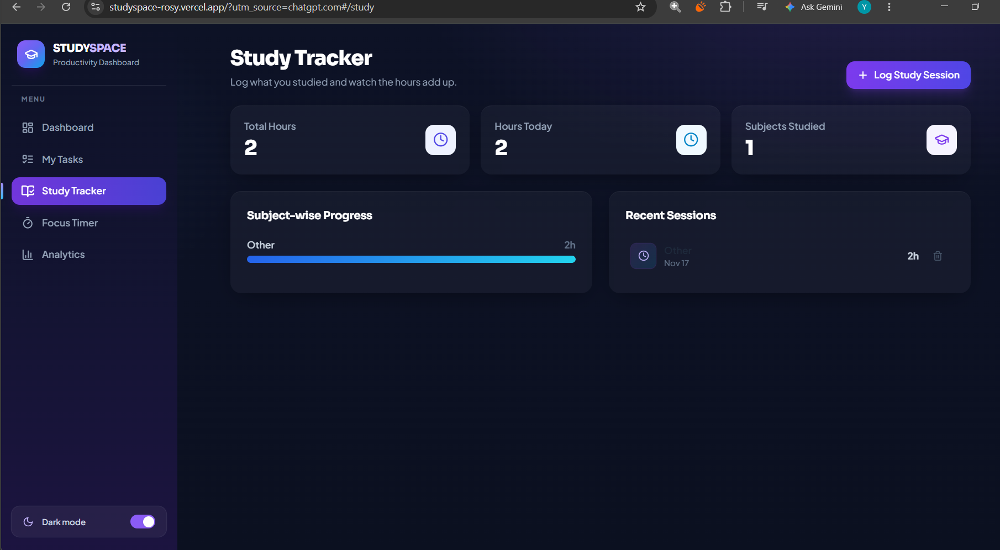
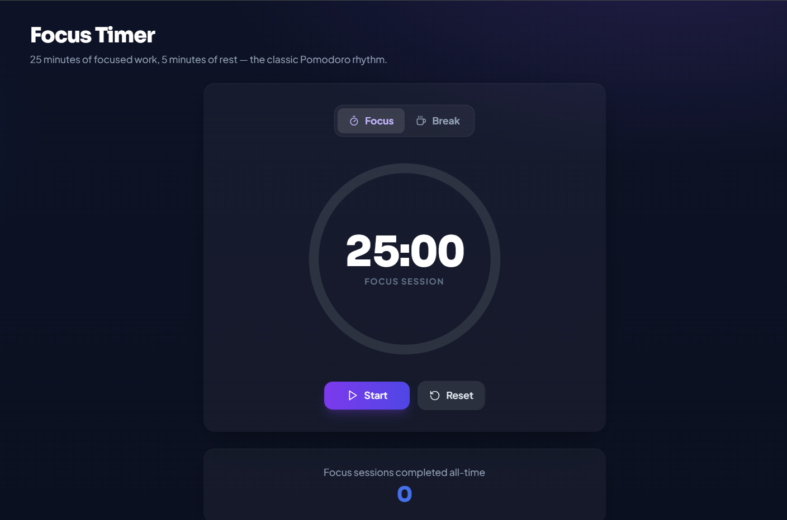
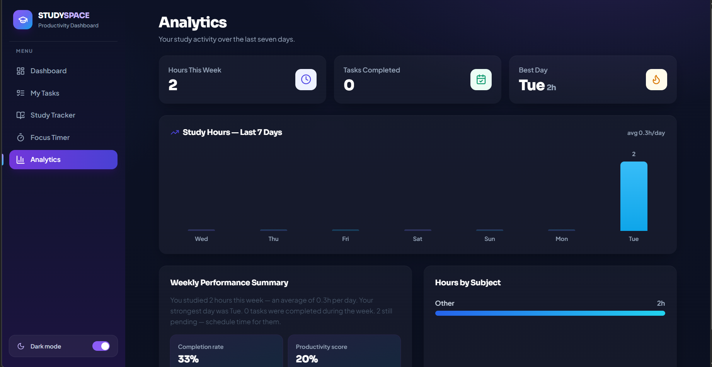

# STUDYSPACE – Student Productivity Dashboard

## About the Project
STUDYSPACE is a student productivity web application designed to help college students organize their academic tasks, track study hours and improve their daily productivity.

## Features
- Daily Task Management with Subject-Wise Filtering
- Study Hours Tracker
- Pomodoro Focus Timer with Customizable Intervals & Audio Chimes
- Daily Productivity Score & Study Streak
- Weekly Progress Analytics & Subject Breakdown
- StudyBuddy AI (Academic AI Assistant powered by Google Gemini)
- Responsive Dashboard & Dark/Light Mode

## Technologies Used
- React
- TypeScript
- Tailwind CSS
- Vite
- LocalStorage

## Screenshots

### Dashboard

### Task Manager

### Study Tracker

### Focus Timer

### Weekly Analytics

## Live Application
https://studyspace-rosy.vercel.app/

## GitHub Repository
https://github.com/yogitagarg29/studyspace

## Installation
1. Clone the repository.
2. Run npm install.
3. Run npm run dev.
4. Open the local development URL in your browser.

## User Feedback and Improvement

**Feedback Received:** Users suggested that finding tasks belonging to a particular subject becomes difficult when the task list contains many entries.

**Improvement Implemented:** Added a subject-wise task filtering feature that allows users to filter tasks by Mathematics, Physics, Chemistry, Biology and Computer Science.

**Result:** Task management became more organized and convenient, allowing students to find academic tasks easily.

## Deployment
The application is deployed using Vercel.
